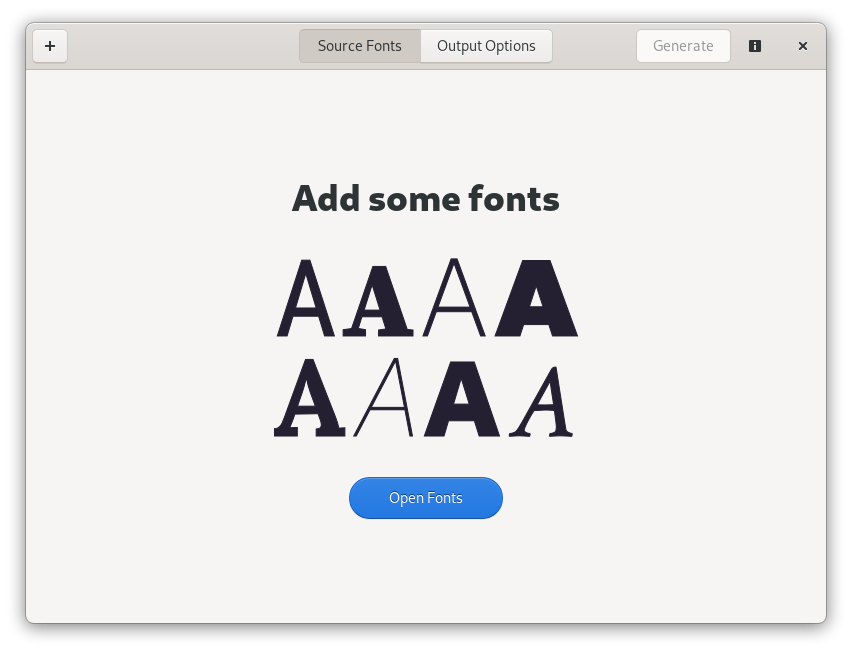
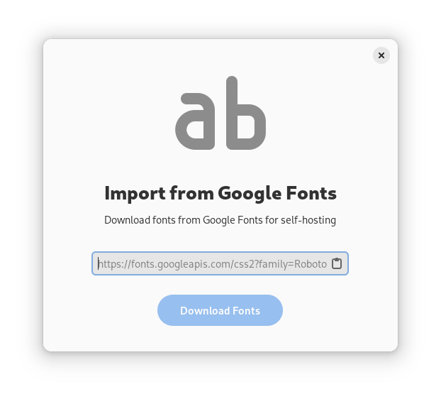
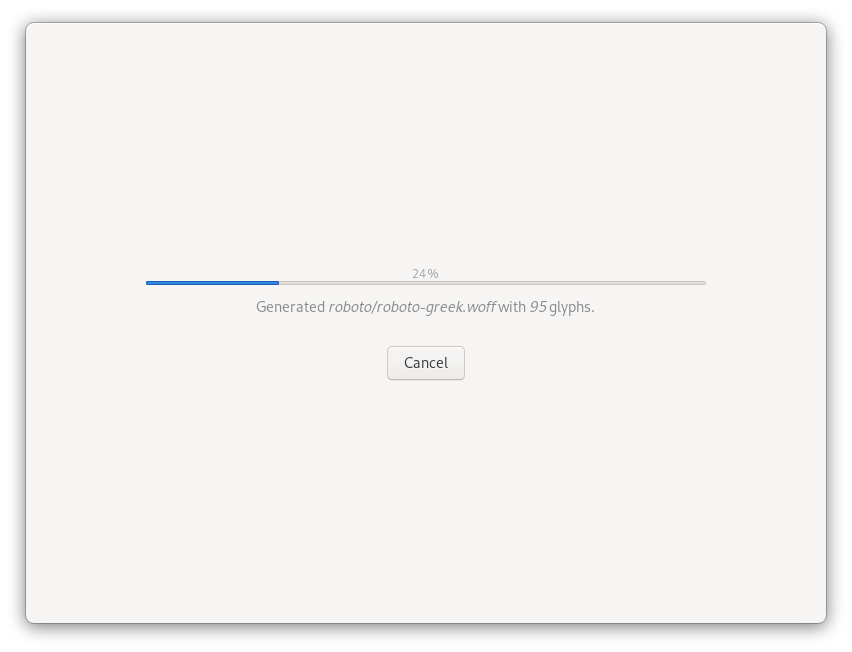
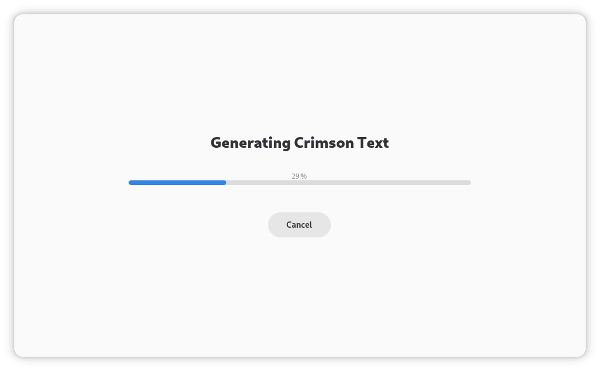
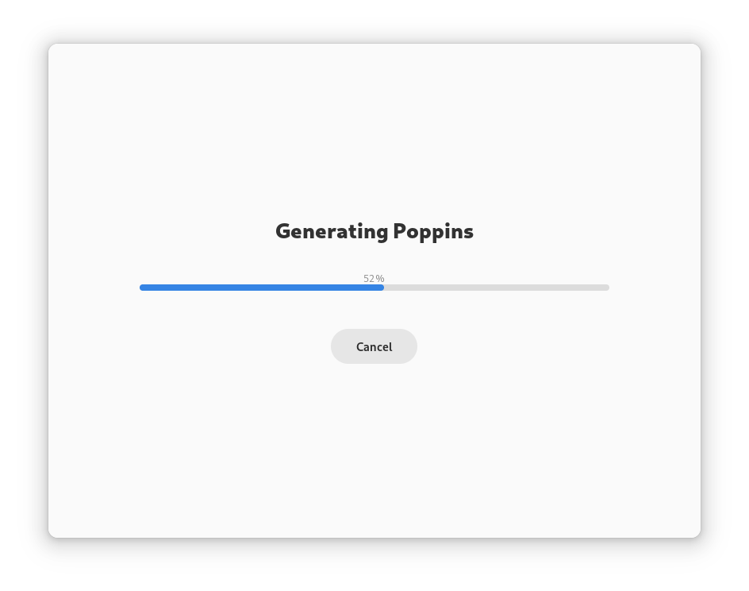

 

# Webfont Bundler

Create @font-face kits easily

<br/>

[](https://stopthemingmy.app) 
[](https://circle.gnome.org/)

[](https://github.com/rafaelmardojai/WebfontKitGenerator/blob/master/COPYING)
[](https://paypal.me/RafaelMardojaiCM)
[](https://liberapay.com/rafaelmardojai/donate)


## Description
**Webfont Bundler** is a simple utility that allows you to generate **woff**, **woff2** and the necessary CSS boilerplate from non-web font formats (otf & ttf).

Webfont Bundler also includes a tool to Download fonts from Google Fonts for self-hosting.

Webfont Bundler uses [fontTools](https://github.com/fonttools/fonttools) python library under the hood.

## Install
<a href="https://flathub.org/apps/details/com.rafaelmardojai.WebfontKitGenerator"></a>

### Third Party Packages

| Distribution | Package | Maintainer |
|:-:|:-:|:-:|
| Ubuntu (PPA) | [`Stable Releases`](https://launchpad.net/~apandada1/+archive/ubuntu/webfontkitgenerator), [`Daily Builds`](https://launchpad.net/~apandada1/+archive/ubuntu/webfontkitgenerator-daily) | [Archisman Panigrahi](https://github.com/apandada1) |
| Arch Linux (AUR) | [`webfontkitgenerator-git`](https://aur.archlinux.org/packages/webfontkitgenerator-git/) | [Archisman Panigrahi](https://github.com/apandada1) |
| Fedora Linux (Copr) | [`webfont-kit-generator`](https://copr.fedorainfracloud.org/coprs/xfgusta/webfont-kit-generator/) | [Gustavo Costa](https://github.com/xfgusta)|

## Building

### Requirements

- Python 3 `python`
- PyGObject `python-gobject`
- GTK4 (>= 4.12.0) `gtk4`
- libadwaita (>= 1.4.0) `libadwaita`
- libsoup (>= 3.0) `libsoup3`
- gtksourceview (>= 5.0) `gtksourceview5`
- Meson `meson`
- Ninja `ninja`
- fontTools `python-fontTools`
- brotli `python-brotli`

Clone and run from GNOME Builder.
Alternatively, you can build with `meson`.
```bash
meson builddir --prefix=/usr/local
sudo ninja -C builddir install
```

### Collect Python deps for flatpak

```bash
build-aux/flatpak-pip-generator  --requirements-file requirements.txt --output=build-aux/python3-requirements
```

## Screenshots

<p align="center">
  
  
  
  
  
</p>

## Translations
Webfont Bundler is translated into several languages. If your language is missing or incomplete, please help to [translate Webfont Bundler in Weblate](https://hosted.weblate.org/engage/webfont-bundler/).

[](https://hosted.weblate.org/engage/webfont-bundler/)

## Credits
Developed by **[Rafael Mardojai CM](https://github.com/rafaelmardojai)** and [contributors](https://github.com/rafaelmardojai/WebfontKitGenerator/graphs/contributors).

## Donate
If you want to support my work, you can donate me, [here you can find how](https://rafaelmardojai.com/donate/).


## 🌐 Web Resources & Aesthetic Symbols Index
- [FREE FIRE CLAN EMPEROR CROWN](https://pastel-soft-symbols-82.pages.dev/symbol/free-fire-clan-emperor-crown/)
- [SYM 1F914](https://fairy-lace-symbols-92.pages.dev/symbol/sym-1f914/)
- [MUSIC WEATHER](https://mecha-matrix-symbols-75.pages.dev/music-weather/)
- [GAMING WEAPONS](https://neon-matrix-symbols-57.pages.dev/vi/gaming-weapons/)
- [SYM 268D](https://kawaii-kaomoji-hub-88.pages.dev/symbol/sym-268d/)
- [SYM 26A8](https://tech-glitch-symbols-36.pages.dev/symbol/sym-26a8/)
- [FLOWER GIRL SMILE KAOMOJI](https://dollcore-bio-symbols-12.pages.dev/symbol/flower-girl-smile-kaomoji/)
- [LAST QUARTER CRESCENT MOON](https://sleek-bio-symbols-40.pages.dev/symbol/last-quarter-crescent-moon/)
- [SYM 2660](https://anime-sparkle-text-50.pages.dev/symbol/sym-2660/)
- [SYM 26B4](https://clean-spacing-fonts-98.pages.dev/symbol/sym-26b4/)
- [SYM 1D476](https://glitch-bio-generator-83.pages.dev/symbol/sym-1d476/)
- [SYM 26A3](https://vintage-lace-fonts-79.pages.dev/symbol/sym-26a3/)
- [SYM 26BB](https://fairy-lace-symbols-92.pages.dev/symbol/sym-26bb/)
- [SYM 260D](https://vintage-lace-fonts-79.pages.dev/symbol/sym-260d/)
- [SYM 1D44C](https://fairy-lace-symbols-92.pages.dev/symbol/sym-1d44c/)
- [SYM 1D432](https://angelic-ribbon-text-78.pages.dev/symbol/sym-1d432/)
- [SYM 1D493](https://glitch-font-studio-46.pages.dev/symbol/sym-1d493/)
- [SYM 1F625](https://occult-runic-fonts-23.pages.dev/symbol/sym-1f625/)
- [SYM 1D465](https://kawaii-kaomoji-hub-99.pages.dev/symbol/sym-1d465/)
- [MUSIC WEATHER](https://cyber-clan-tags-85.pages.dev/vi/music-weather/)
- [SYM 265F](https://theeduplaycampen.pages.dev/symbol/sym-265f/)
- [SYM 1D45D](https://aesthetic-spacing-fonts-10.pages.dev/symbol/sym-1d45d/)
- [ROTATED FLORAL HEART](https://gothic-bio-fonts-55.pages.dev/symbol/rotated-floral-heart/)
- [SYM 2725](https://cyber-clan-tags-47.pages.dev/symbol/sym-2725/)
- [KAOMOJI](https://vintage-script-symbols-65.pages.dev/vi/kaomoji/)
- [SYM 1D485](https://anime-sparkle-text-51.pages.dev/symbol/sym-1d485/)
- [SYM 26C6](https://vintage-coquette-text-58.pages.dev/symbol/sym-26c6/)
- [SYM 2671](https://chibi-bunny-symbols-82.pages.dev/symbol/sym-2671/)
- [AESTHETIC STARDUST COMBO](https://techno-hacker-text-43.pages.dev/symbol/aesthetic-stardust-combo/)
- [SYM 2613](https://chibi-emotion-faces-74.pages.dev/symbol/sym-2613/)
- [INSTAGRAM BIO](https://gothic-bio-fonts-69.pages.dev/instagram-bio/)
- [SYM 1D417](https://minimal-star-symbols-35.pages.dev/symbol/sym-1d417/)
- [BRACKETS](https://neon-matrix-symbols-94.pages.dev/es/brackets/)
- [SYM 2674](https://angelic-bio-symbols-59.pages.dev/symbol/sym-2674/)
- [SYM 1D49F](https://pastel-chibi-emojis-45.pages.dev/symbol/sym-1d49f/)
- [SYM 263A](https://anime-sparkle-text-51.pages.dev/symbol/sym-263a/)
- [SYM 265A](https://vintage-lace-symbols-54.pages.dev/symbol/sym-265a/)
- [SYM 2632](https://gothic-bio-fonts-55.pages.dev/symbol/sym-2632/)
- [SYM 1F61D](https://ribbon-bow-unicode-18.pages.dev/symbol/sym-1f61d/)
- [SYM 1D465](https://cyber-clan-tags-90.pages.dev/symbol/sym-1d465/)
- [MUSIC WEATHER](https://gothic-bio-fonts-69.pages.dev/ja/music-weather/)
- [SYM 2636](https://glitch-bio-generator-83.pages.dev/symbol/sym-2636/)
- [LIBRA ZODIAC SCALES](https://synthwave-text-vault-95.pages.dev/symbol/libra-zodiac-scales/)
- [SYM 273D](https://neon-glitch-fonts-64.pages.dev/symbol/sym-273d/)
- [SYM 1D42C](https://monochrome-bio-text-12.pages.dev/symbol/sym-1d42c/)
- [SYM 1D456](https://anime-sparkle-text-14.pages.dev/symbol/sym-1d456/)
- [SYM 26D6](https://baroque-aesthetic-symbols-59.pages.dev/symbol/sym-26d6/)
- [SYM 1F4A9](https://cyber-clan-tags-90.pages.dev/symbol/sym-1f4a9/)
- [SYM 1F62A](https://gothic-bio-fonts-69.pages.dev/symbol/sym-1f62a/)
- [SYM 2668](https://mecha-crosshair-symbols-38.pages.dev/symbol/sym-2668/)
- [GAMING WEAPONS](https://theeduplaycampen.pages.dev/gaming-weapons/)
- [SYM 1F479](https://moe-kaomoji-symbols-15.pages.dev/symbol/sym-1f479/)
- [SYM 1F637](https://soft-angel-symbols-21.pages.dev/symbol/sym-1f637/)
- [TENDER GENTLE TEAR KAOMOJI](https://sleek-mono-symbols-75.pages.dev/symbol/tender-gentle-tear-kaomoji/)
- [CURLY RIBBON LOOP](https://anime-sparkle-text-51.pages.dev/symbol/curly-ribbon-loop/)
- [SYM 1F625](https://gothic-bio-fonts-55.pages.dev/symbol/sym-1f625/)
- [SYM 1D41B](https://minimal-star-symbols-89.pages.dev/symbol/sym-1d41b/)
- [SYM 2664](https://cyber-clan-tags-47.pages.dev/symbol/sym-2664/)
- [SYM 263A FE0F](https://theeduplaycampen.pages.dev/symbol/sym-263a-fe0f/)
- [SYM 265B](https://vintage-lace-symbols-54.pages.dev/symbol/sym-265b/)
- [SYM 1F62D](https://vintage-lace-symbols-54.pages.dev/symbol/sym-1f62d/)
- [SYM 26F9](https://zen-unicode-text-36.pages.dev/symbol/sym-26f9/)
- [SYM 1D49A](https://kawaii-kaomoji-hub-99.pages.dev/symbol/sym-1d49a/)
- [SYM 1F910](https://daintystar-font-studio-48.pages.dev/symbol/sym-1f910/)
- [SYM 267F](https://neon-matrix-symbols-94.pages.dev/symbol/sym-267f/)
- [SYM 2631](https://angelic-bio-symbols-59.pages.dev/symbol/sym-2631/)
- [SYM 2613](https://sleek-arrow-symbols-42.pages.dev/symbol/sym-2613/)
- [SYM 1D40B](https://moe-kaomoji-symbols-15.pages.dev/symbol/sym-1d40b/)
- [SYM 263B](https://zen-unicode-symbols-89.pages.dev/symbol/sym-263b/)
- [LEFT BLACK LENTICULAR BRACKET](https://neon-glitch-fonts-20.pages.dev/symbol/left-black-lenticular-bracket/)
- [SYM 1FA75](https://kawaii-kaomoji-hub-51.pages.dev/symbol/sym-1fa75/)
- [SYM 1F630](https://neon-glitch-fonts-20.pages.dev/symbol/sym-1f630/)
- [SYM 1F496](https://scholarly-runes-text-68.pages.dev/symbol/sym-1f496/)
- [SYM 1F49A](https://aesthetic-bullet-points-76.pages.dev/symbol/sym-1f49a/)
- [SYM 26DC](https://cyber-clan-tags-47.pages.dev/symbol/sym-26dc/)
- [SYM 1D463](https://cyber-clan-tags-36.pages.dev/symbol/sym-1d463/)
- [SYM 26AC](https://neon-matrix-symbols-94.pages.dev/symbol/sym-26ac/)
- [SYM 1D440](https://neon-matrix-symbols-94.pages.dev/symbol/sym-1d440/)
- [SYM 1F627](https://anime-sparkle-text-70.pages.dev/symbol/sym-1f627/)
- [SYM 1F60F](https://fairy-lace-symbols-92.pages.dev/symbol/sym-1f60f/)
- [SPRING TULIP BLOSSOM](https://occult-rune-symbols-64.pages.dev/symbol/spring-tulip-blossom/)
- [SYM 1F630](https://moe-kaomoji-symbols-15.pages.dev/symbol/sym-1f630/)
- [SYM 1D472](https://modern-bullet-symbols-45.pages.dev/symbol/sym-1d472/)
- [OUTLINED STAR](https://pastel-moe-emoticons-55.pages.dev/symbol/outlined-star/)
- [FOUR POINT STAR SPARKLE](https://daintystar-font-studio-48.pages.dev/symbol/four-point-star-sparkle/)
- [SYM 273B](https://vintage-lace-fonts-79.pages.dev/symbol/sym-273b/)
- [SYM 262D](https://baroque-crown-unicode-60.pages.dev/symbol/sym-262d/)
- [SYM 1D427](https://cyber-clan-tags-36.pages.dev/symbol/sym-1d427/)
- [SYM 2638](https://modern-bullet-symbols-45.pages.dev/symbol/sym-2638/)
- [SYM 26F2](https://vintage-scholarly-text-77.pages.dev/symbol/sym-26f2/)
- [SYM 26C5](https://pastel-chibi-emojis-45.pages.dev/symbol/sym-26c5/)
- [SHADOWED WHITE STAR](https://cyber-clan-tags-90.pages.dev/symbol/shadowed-white-star/)
- [SYM 1F4A9](https://vintage-lace-fonts-79.pages.dev/symbol/sym-1f4a9/)
- [SYM 1F638](https://mecha-crosshair-symbols-38.pages.dev/symbol/sym-1f638/)
- [SYM 1F62C](https://sleek-mono-symbols-75.pages.dev/symbol/sym-1f62c/)
- [SYM 1D459](https://poetic-scroll-fonts-91.pages.dev/symbol/sym-1d459/)
- [MUSIC WEATHER](https://clean-spacing-fonts-98.pages.dev/es/music-weather/)
- [SYM 1D47F](https://anime-sparkle-text-70.pages.dev/symbol/sym-1d47f/)
- [SYM 1D424](https://coquette-aesthetic-symbols-48.pages.dev/symbol/sym-1d424/)
- [SYM 26E2](https://pearl-heart-symbols-95.pages.dev/symbol/sym-26e2/)
- [LIBRA ZODIAC SCALES](https://vintage-script-symbols-65.pages.dev/symbol/libra-zodiac-scales/)
- [SYM 1D469](https://modern-bullet-symbols-45.pages.dev/symbol/sym-1d469/)
- [VIRGO ZODIAC MAIDEN](https://vintage-script-symbols-65.pages.dev/symbol/virgo-zodiac-maiden/)
- [SYM 1D45E](https://cyber-clan-tags-36.pages.dev/symbol/sym-1d45e/)
- [SYM 26FD](https://anime-sparkle-text-51.pages.dev/symbol/sym-26fd/)
- [HIGH VOLTAGE LIGHTNING](https://theeduplaycampen.pages.dev/symbol/high-voltage-lightning/)
- [SYM 1D454](https://minimal-star-symbols-89.pages.dev/symbol/sym-1d454/)
- [SYM 1D44B](https://sleek-mono-symbols-75.pages.dev/symbol/sym-1d44b/)
- [SYM 1F612](https://monochrome-bio-text-12.pages.dev/symbol/sym-1f612/)
- [SYM 1F619](https://vintage-script-symbols-65.pages.dev/symbol/sym-1f619/)
- [SYM 1F49B](https://vintage-lace-fonts-79.pages.dev/symbol/sym-1f49b/)
- [SYM 26FE](https://cyber-clan-tags-47.pages.dev/symbol/sym-26fe/)
- [SYM 265E](https://vintage-lace-symbols-54.pages.dev/symbol/sym-265e/)
- [HEARTS](https://kawaii-kaomoji-hub-51.pages.dev/ja/hearts/)
- [SWIMMING FISH LEFT](https://sleek-mono-symbols-75.pages.dev/symbol/swimming-fish-left/)
- [SYM 1FA75](https://monochrome-bio-text-12.pages.dev/symbol/sym-1fa75/)
- [SYM 1D422](https://cyber-clan-tags-47.pages.dev/symbol/sym-1d422/)
- [SYM 1D4A5](https://vintage-coquette-text-58.pages.dev/symbol/sym-1d4a5/)
- [SYM 1D415](https://cyber-clan-tags-36.pages.dev/symbol/sym-1d415/)
- [SYM 2610](https://kawaii-kaomoji-hub-51.pages.dev/symbol/sym-2610/)
- [RIGHT MATHEMATICAL WHITE SQUARE BRACKET](https://glitch-mecha-kaomoji-69.pages.dev/symbol/right-mathematical-white-square-bracket/)
- [SYM 1D422](https://lace-and-ribbon-text-61.pages.dev/symbol/sym-1d422/)
- [SYM 2662](https://vintage-lace-fonts-79.pages.dev/symbol/sym-2662/)
- [SYM 262B](https://kawaii-kaomoji-hub-51.pages.dev/symbol/sym-262b/)
- [SYM 1F971](https://kawaii-kaomoji-hub-51.pages.dev/symbol/sym-1f971/)
- [SYM 1F615](https://gothic-bio-fonts-55.pages.dev/symbol/sym-1f615/)
- [BORDERS DIVIDERS](https://scholarly-runes-text-68.pages.dev/ja/borders-dividers/)
- [SYM 26D4](https://vintage-coquette-text-58.pages.dev/symbol/sym-26d4/)
- [SYM 1D41D](https://sleek-arrow-symbols-42.pages.dev/symbol/sym-1d41d/)
- [SYM 1D40F](https://neon-matrix-symbols-57.pages.dev/symbol/sym-1d40f/)
